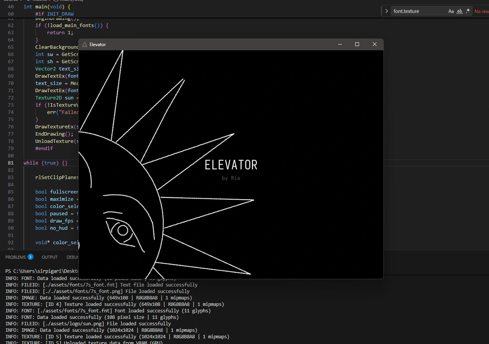
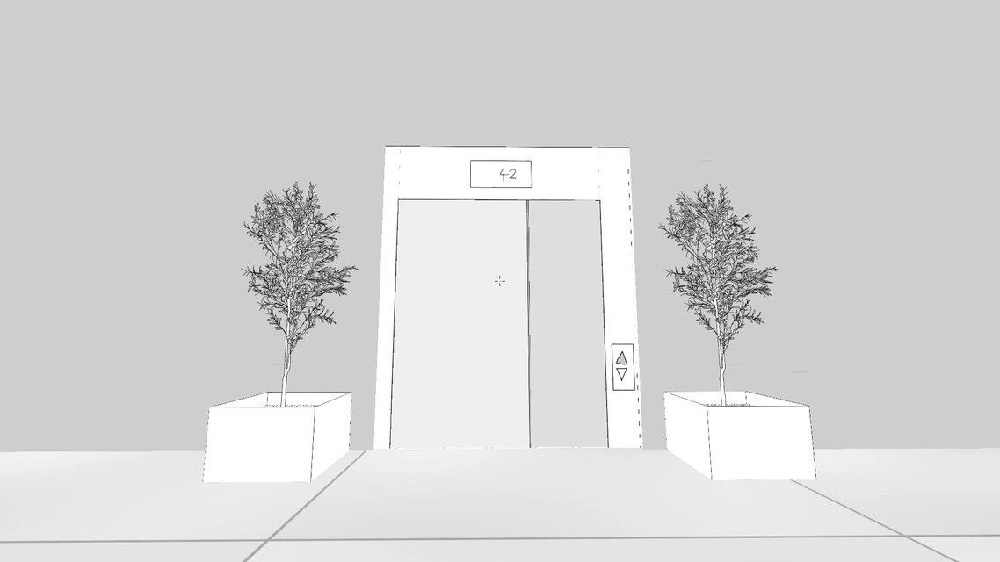
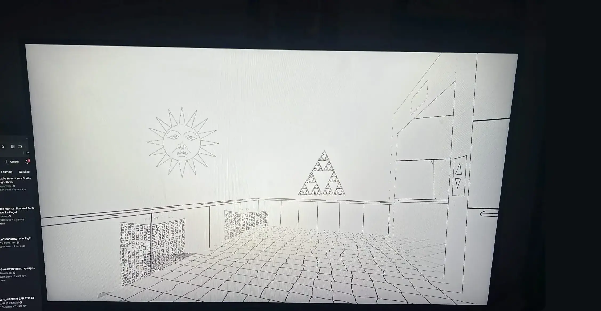

# DEVLOG!!

Hiii this is my devlog of my game currently called *"Elevator"* (can change its just a placeholder tbh)  

##

[video](https://drive.google.com/file/d/1kZuvA8B23FAqv6ICvZSmi8Dm90Etxbcd/view?usp=sharing)

## 

## 

the computer input panel, with 100 "knobs" and 100 coresponding s7 displays  
wierd perspective because why not

## 

<video src="../images/devlog2.mp4" controls></video>

screenrecoding of the "gameplay"

## 

heres the first "screenshot" i have (its just a photo i took with my phone because i was too lazy to actually screenshot):

## 
